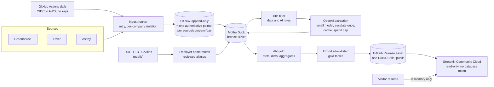

# JobPulse

Daily job-market intelligence for data and AI roles. Every day it pulls the public job boards of 43 tech employers, tracks each posting over time, reads the data and AI postings with a small LLM, adds public H-1B filing evidence from the US Department of Labor, and serves it all in a Streamlit app.

**Live app: [jobpulse-insights.streamlit.app](https://jobpulse-insights.streamlit.app)** (Streamlit Community Cloud; it may take a few seconds to wake up if idle).

**Screenshots:** _to be added: Home, Market overview (map), Salary (heatmap), Visa intelligence, Resume match._

- Product spec: [docs/SPEC.md](docs/SPEC.md)
- Architecture: [docs/ARCHITECTURE.md](docs/ARCHITECTURE.md)
- Roadmap, risks and runbook: [docs/ROADMAP.md](docs/ROADMAP.md)
- Session log: [docs/NOTES.md](docs/NOTES.md)

## Highlights

- **Daily production pipeline.** GitHub Actions ingests 43 employers' public job boards every day into append-only S3 snapshots, then MotherDuck, dbt, LLM extraction and a published gold layer. A failing company or source never stops the run.
- **Keyless AWS.** CI reaches AWS through GitHub OIDC pinned to one repository environment. There are no access keys anywhere, and the infrastructure is Terraform.
- **LLM extraction at $0.39 per 1,000 postings.** A small model reads only data and AI roles, escalates once to a stronger model on validation failure, caches by content hash and stops at a spend cap.
- **9,874 certified H-1B filings matched to 42 of 43 employers.** Employer-name matching scored 100% precision on the 35 labeled matched pairs (95% interval 90.1% to 100%). Visa data is shown as evidence, never as a promise.
- **Public app with zero credentials.** The deployed app holds no database token: it downloads a validated export of the allow-listed gold tables from a public GitHub Release and opens it read-only. Resumes are processed in memory and never stored.

## What it does

| Page | What you get |
|---|---|
| Home | The headline numbers (open postings with the weekly change, top skill, median advertised pay, H-1B coverage) and links to everything else |
| Market overview | Open postings by company, role family and remote policy, a map of open postings by city, and how much of the data is analyzed |
| Hiring trends | New and closed postings per day, skills employers ask for |
| Salary | Advertised pay by role, seniority and city (with coverage %), and, in a separate tab, wages on H-1B filings |
| Visa intelligence | Top sponsors, a company lookup card, and what postings say about sponsorship. Evidence, not a promise. |
| Resume match | Paste a resume or upload a PDF, get open data and AI postings ranked by skill overlap, with matched and missing skills, visa evidence and advertised salary. No AI call, no storage. |
| Pipeline health | Data freshness, recent runs, data quality and AI extraction cost |

### 2-minute demo script

1. **Home** (0:00): the four headline cards; follow one link.
2. **Market overview** (0:15): open roles by company and role family, the key-insight lines, and the map; note the "analyzed" coverage line.
3. **Hiring trends** (0:35): new and closed postings per day; pick a skill.
4. **Salary** (0:55): advertised ranges with coverage %, then the separate LCA offered-wage tab.
5. **Visa intelligence** (1:15): top sponsors; look up one company and read the evidence card.
6. **Resume match** (1:40): paste a resume, read the matches and the missing skills, filter by visa evidence (a filter, never part of the score), press **Delete my resume data**.
7. **Pipeline health** and the evaluation reports in [`eval/reports/`](eval/reports/) (1:55).

## Architecture



Design points worth knowing:
- **Closure is conservative.** A posting is closed only after it is missing from two consecutive complete daily snapshots. A failed or truncated fetch never implies closure.
- **Advertised salary and LCA wages are never blended.** They are different things and live in separate views.
- **The public app holds no credential.** The daily workflow exports only the allow-listed gold tables into one DuckDB file and uploads it to a public GitHub Release. The app downloads that file and opens it read-only. See [docs/ARCHITECTURE.md](docs/ARCHITECTURE.md).
- **Resume privacy.** The resume is parsed in memory, never written, logged or cached; only skills, a few title lines and a years figure stay in the session until you press Delete. Tests enforce this ([`tests/unit/test_resume.py`](tests/unit/test_resume.py)).

## Key numbers

All figures are as of 2026-11-20 (data through that day's snapshot) and come from the script named in the last column. Refresh them with `uv run python scripts/gold_report.py`, `scripts/extraction_counts.py` and `scripts/report_extraction_cost.py` (and `scripts/warehouse_counts.py`, which needs the MotherDuck token). The live app shows the same counts on Home, Market overview and Pipeline health.

| Figure | Value | Produced by |
|---|---|---|
| Employers tracked | 43 | `scripts/gold_report.py` |
| Postings seen since 10 Nov 2026 / open now | 9,681 / 8,445 | `scripts/gold_report.py` |
| Open data and AI roles (title filter) | 515 | `scripts/extraction_counts.py` |
| Of those, read by the LLM | 515 (100%) | `scripts/gold_report.py`, `scripts/extraction_counts.py` |
| Analyzed postings with an advertised salary | 72.8% | `scripts/gold_report.py` |
| Open postings with a parsed city | 62.3% | `scripts/gold_report.py` |
| Canonical skills | 2,612 | `scripts/gold_report.py` |
| Raw posting rows / observations | 91,119 / 98,700 | `scripts/warehouse_counts.py` |
| LLM cost per 1,000 postings | $0.39 | `scripts/report_extraction_cost.py` |
| Escalation to the stronger model / quarantined | 2.3% / 0.0% | `scripts/report_extraction_cost.py` |
| Total extraction spend (excluding evaluation-only calls) | $0.25 | `scripts/report_extraction_cost.py` |
| Companies matched to H-1B filings | 42 of 43 | `scripts/gold_report.py` |
| Certified H-1B filings matched (FY2025-FY2026) | 9,874 | `scripts/gold_report.py` |
| Employer-match precision | 100% (35 of 35 matched pairs; 95% interval 90.1% to 100%) | `eval/employer_match_score.py` |
| Hand-labeled pilot (n=38): salary min/max, currency | 96.4% precision and recall | `eval/score.py` ([report](eval/reports/extraction_report.md)) |
| Hand-labeled pilot (n=38): role family | 71.1% precision, 75.0% recall | `eval/score.py` |
| Hand-labeled pilot (n=38): seniority, exact / with staff+ folded into senior | 55.3% / 81.6% precision | `eval/score.py` |
| Two models agree on role family / seniority (n=100, not accuracy) | 96% / 88% | `eval/agreement.py` ([report](eval/reports/agreement_report.md)) |

## Honest limitations

- **Extraction accuracy is only lightly measured.** The only human-labeled benchmark is 38 postings (labeling was stopped at the owner's decision, not the planned 200). Skill recall there is about 45%. The other reports (salary cross-check, grounding, cross-model agreement) measure consistency, not accuracy.
- **Short history.** Data starts on 10 Nov 2026. Closures need two consecutive daily snapshots, so trends are thin and early numbers are baselines.
- **Not the whole market.** 43 hand-picked employers on three applicant-tracking systems. Only postings whose titles look like data and AI roles are read by the LLM (all 515 open ones today); the rest are counted but not analyzed.
- **Visa data is evidence, not a promise.** H-1B filings show that an employer has filed, not that any role is sponsored. By-role filing counts are lower bounds (role family is a title keyword match). Sponsorship statements exist for very few postings.
- **Advertised pay is incomplete.** About 73% of analyzed postings state a salary. Hourly and monthly pay (interns especially) is shown as a yearly equivalent, not a salary, and the Home median leaves interns out. Wages on filings are offered wages (a lower bound of the filed range) and are shown separately.
- **Resume match is overlap, not fit.** Skills are looked up deterministically in a vocabulary built from the postings: unknown spellings, synonyms, non-English text and scanned PDFs are missed. Experience level is a pre-selected filter (from years and titles in the resume), never part of the score; short postings that list few skills can score high; and only about half of the postings carry an apply link (links are shown only for the main applicant-tracking hosts).
- **Freshness.** The public file is rebuilt once a day after the pipeline finishes (GitHub's scheduler can start hours late), and the app caches it for an hour.
- **Free hosting.** The app can sleep when idle on Streamlit Community Cloud.

## Future work

- P7: a guarded text-to-SQL agent and RAG over postings, with a 50-question benchmark that includes refusals and red-team prompts.
- A larger labeled evaluation, to replace the 38-row pilot with real accuracy numbers.
- Resume skill synonyms or embeddings, and a fit score that understands experience.
- More employers and sources (USAJobs, Remotive; Adzuna if the API becomes affordable); FY2024 H-1B data.

## Development

```bash
uv sync                      # Python 3.12 environment
make check                   # ruff, mypy, pytest, terraform fmt/validate, gitleaks (if installed)
uv run pytest -m live        # optional smoke tests against the real public APIs

# Ingest today's boards into a local directory (no AWS needed)
uv run jobpulse ingest --local-dir .local_data
uv run jobpulse check-freshness --local-dir .local_data

# Run the app against a local warehouse file, or against the published export
JOBPULSE_APP_DB=path/to/warehouse.duckdb uv run streamlit run app/streamlit_app.py
JOBPULSE_GOLD_URL=https://github.com/akshaygovindd/jobpulse/releases/download/gold-latest/jobpulse_gold.duckdb \
  uv run streamlit run app/streamlit_app.py
```

`--snapshot-date` only accepts the current UTC date, so a missed day stays a gap and is never backfilled.

Source attribution:
- Map basemap © OpenStreetMap contributors © CARTO
- [Greenhouse Job Board API](https://developers.greenhouse.io/job-board.html)
- [Lever Postings API](https://github.com/lever/postings-api)
- Ashby public job board API
- [US Department of Labor OFLC LCA disclosure data](https://www.dol.gov/agencies/eta/foreign-labor/performance)

---

Developed with AI-assisted tooling (Claude Code). Architecture, evaluation design, and technical decisions are my own.
