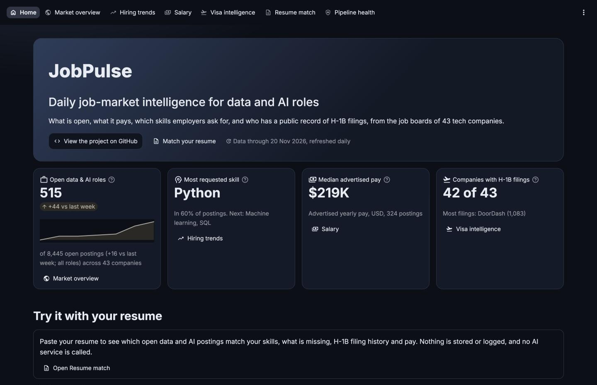
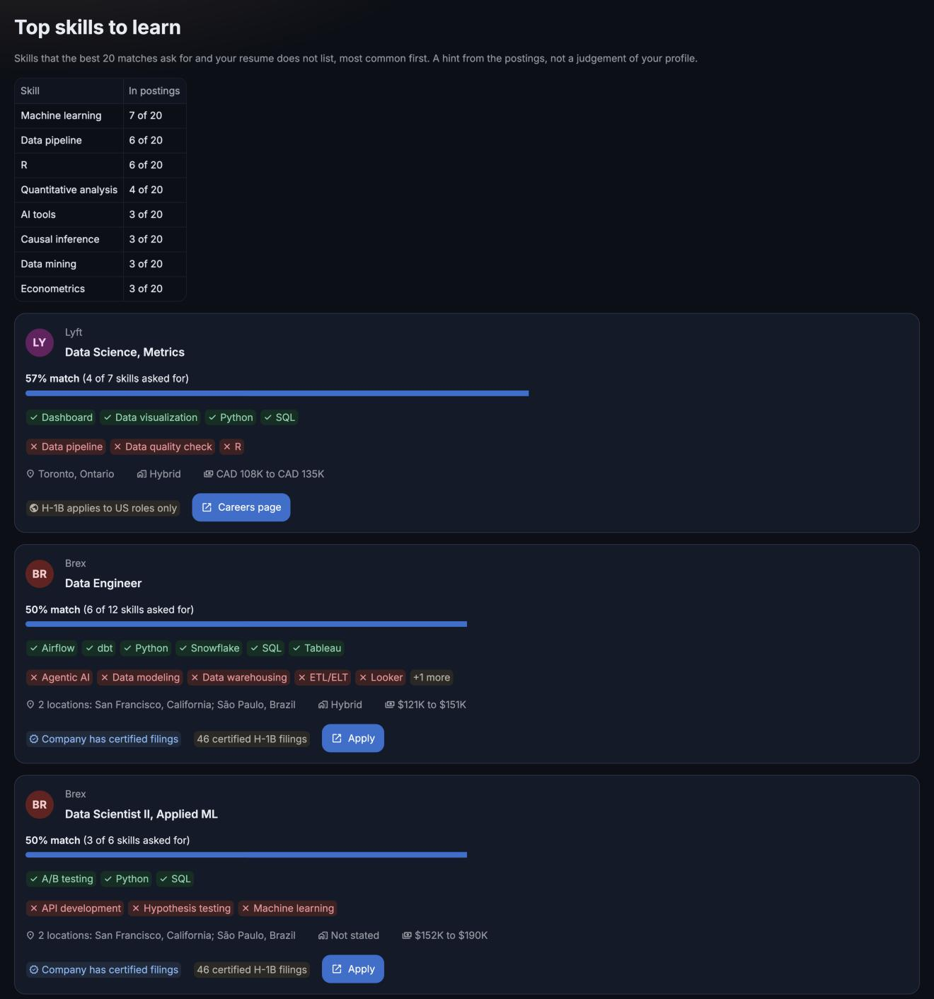
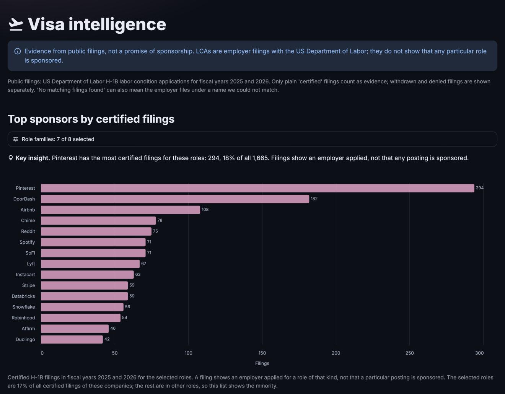
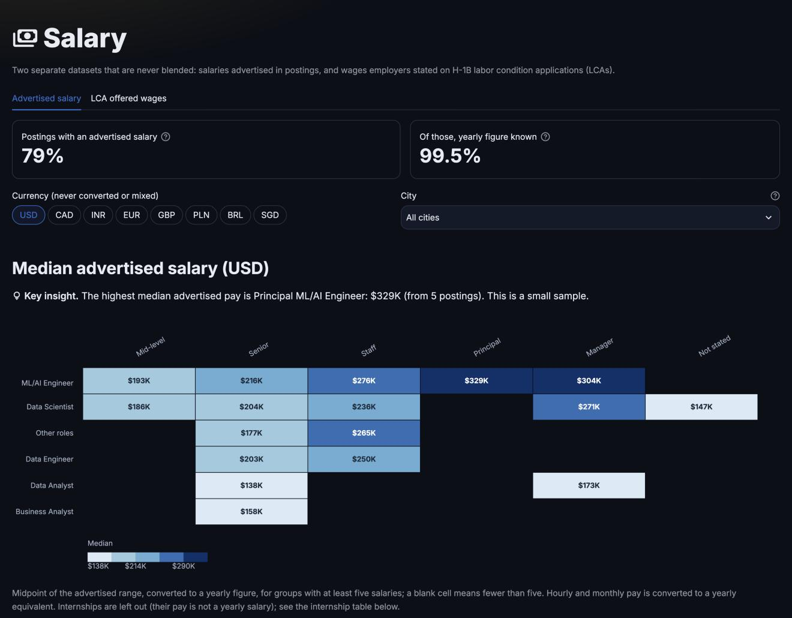
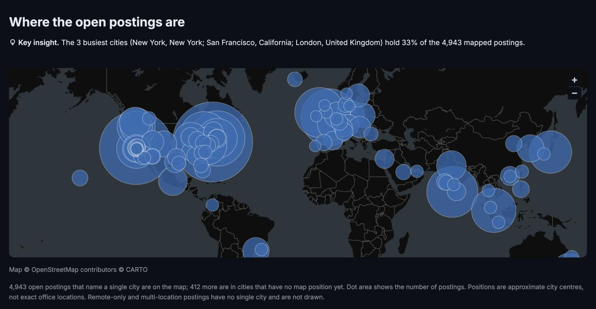
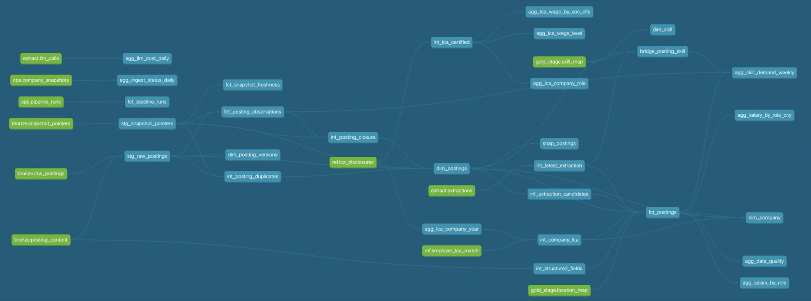
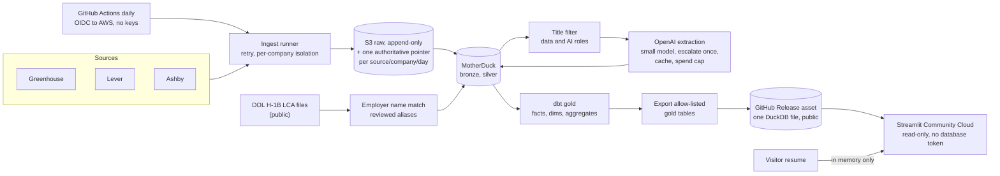
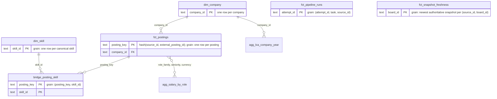

# JobPulse

A production-style daily data platform for job-market intelligence on data and AI roles. Deployed, running daily and being hardened (not finished). Every day it pulls the public job boards of 43 tech employers, tracks each posting over time, reads the data and AI postings with a small LLM, adds public H-1B filing evidence from the US Department of Labor, and serves it all in a Streamlit app.

**Live app: [jobpulse-insights.streamlit.app](https://jobpulse-insights.streamlit.app)** (Streamlit Community Cloud; it may take a few seconds to wake up if idle).

| | |
|---|---|
| <br>**Home:** headline numbers and links | <br>**Resume match:** postings ranked by skill overlap |
| <br>**Visa intelligence:** top sponsors, evidence not a promise | <br>**Salary:** advertised pay with coverage % |
| <br>**Map:** open postings by city | <br>**Lineage:** the dbt graph |

<details><summary>More screenshots</summary>

- [Market overview](docs/screenshots/market.jpg)
- [Visa company lookup](docs/screenshots/visa_company.png)
- [Pipeline health](docs/screenshots/pipeline_health.png)
- [Mobile home](docs/screenshots/mobile_home.png)

</details>

- Product spec: [docs/SPEC.md](docs/SPEC.md)
- Architecture: [docs/ARCHITECTURE.md](docs/ARCHITECTURE.md)
- Roadmap, risks and runbook: [docs/ROADMAP.md](docs/ROADMAP.md)
- Session log: [docs/NOTES.md](docs/NOTES.md)
- dbt docs and lineage graph: <https://akshaygovindd.github.io/jobpulse/> (published by [`dbt_docs.yml`](.github/workflows/dbt_docs.yml) on GitHub Pages; needs Settings > Pages > Source = GitHub Actions, set once by the owner)

## Highlights

- **Daily pipeline, 43/43 complete on every daily run since 10 Nov** (11 days, through 20 Nov). GitHub Actions ingests 43 employers' public job boards every day into append-only S3 snapshots, then MotherDuck, dbt, LLM extraction and a published gold layer. A failing company or source never stops the run.
- **Keyless AWS.** CI reaches AWS through GitHub OIDC pinned to one repository environment. There are no access keys anywhere, and the infrastructure is Terraform.
- **LLM extraction at $0.39 per 1,000 postings.** A small model reads only data and AI roles, escalates once to a stronger model on validation failure, caches by content hash and stops at a spend cap.
- **9,874 certified H-1B filings matched to 42 of 43 employers.** Employer-name matching scored 100% precision on the 35 labeled matched pairs (95% interval 90.1% to 100%). Recall was not measured. Visa data is evidence, never a prediction or a promise.
- **Public app with zero credentials.** The deployed app holds no database token: it downloads a validated export of the allow-listed gold tables from a public GitHub Release and opens it read-only. Resume files and raw text are never saved, logged or sent to an AI; extracted skills are held only in session memory until Delete or tab close.

## What it does

| Page | What you get |
|---|---|
| Home | The headline numbers (open postings with the weekly change, top skill, median advertised pay, H-1B coverage) and links to everything else |
| Market overview | Open postings by company, role family and remote policy, a map of open postings by city, and how much of the data is analyzed |
| Hiring trends | New and closed postings per day, skills employers ask for |
| Salary | Advertised pay by role, seniority and city (with coverage %), and, in a separate tab, wages on H-1B filings |
| Visa intelligence | Top sponsors, a company lookup card, and what postings say about sponsorship. Evidence, not a promise. |
| Resume match | Paste a resume or upload a PDF, get open data and AI postings ranked by skill overlap, with matched and missing skills, visa evidence and advertised salary. No AI call. Resume files and raw text are never saved, logged or sent to an AI; extracted skills are held only in session memory until Delete or tab close. |
| Pipeline health | Data freshness, recent runs, data quality and AI extraction cost |

### 2-minute demo script

1. **Home** (0:00): the four headline cards; follow one link.
2. **Market overview** (0:15): open roles by company and role family, the key-insight lines, and the map; note the "analyzed" coverage line.
3. **Hiring trends** (0:35): new and closed postings per day; pick a skill.
4. **Salary** (0:55): advertised ranges with coverage %, then the separate LCA offered-wage tab.
5. **Visa intelligence** (1:15): top sponsors; look up one company and read the evidence card.
6. **Resume match** (1:40): paste a resume, read the matches and the missing skills, filter by visa evidence (a filter, never part of the score), press **Delete my resume data**.
7. **Pipeline health**, the [dbt lineage graph](https://akshaygovindd.github.io/jobpulse/) and the evaluation reports in [`eval/reports/`](eval/reports/) (1:55).

## Architecture



Design points worth knowing:
- **Tests.** pytest, ruff and mypy run on every push in CI. The dbt tests (146 data tests) run inside the daily pipeline on the real warehouse, not in per-push CI. Browser QA of the app is automated and its findings are fixed in the open ([docs/QA_REPORT.md](docs/QA_REPORT.md)); no score is claimed.
- **Closure is conservative.** A posting is closed only after it is missing from two consecutive complete daily snapshots. A failed or truncated fetch never implies closure.
- **Advertised salary and LCA wages are never blended.** They are different things and live in separate views.
- **The public app holds no credential.** The daily workflow exports only the allow-listed gold tables into one DuckDB file and uploads it to a public GitHub Release. The app downloads that file and opens it read-only. See [docs/ARCHITECTURE.md](docs/ARCHITECTURE.md).
- **Resume privacy.** Resume files and raw text are never saved, logged or sent to an AI; extracted skills are held only in session memory until Delete or tab close. Tests enforce this ([`tests/unit/test_resume.py`](tests/unit/test_resume.py)).

## Gold dimensional model

Facts and dimensions are dbt models in schema `gold` (the app reads an allow-listed export of them). Every model has a uniqueness and not-null test on its grain; these run in the daily pipeline. The full lineage graph is in the [dbt docs](https://akshaygovindd.github.io/jobpulse/).



Advertised salary (`agg_salary_by_role*`) and H-1B wages (`agg_lca_*`) are separate aggregates and are never joined or blended. Silver (`dim_postings`, `fct_posting_observations`, `int_posting_closure`) holds posting identity and closure and is documented in [docs/ARCHITECTURE.md](docs/ARCHITECTURE.md).

## Failure drill

A fetch that fails or is truncated must never close a posting. [`test_c_failed_fetch_day_has_no_pointer_and_does_not_count`](tests/unit/test_bronze_silver.py) proves it: posting 1 is seen on day 1 and absent on day 2; on day 3 the company's board is rate limited, so no authoritative pointer is written; the pipeline runs and posting 1 is still `active`. The same file has the counterpart (two consecutive complete absences do close it), and [`tests/unit/test_connectors.py`](tests/unit/test_connectors.py) checks that count mismatches, pagination drift and empty boards are reported as `truncated` rather than complete.

## Operations: one real day (2026-11-20)

From `fct_pipeline_runs`, `agg_ingest_status_daily` and `agg_llm_cost_daily` (the Pipeline health page shows the same). The day had several runs because of manual re-runs; the figures below are the latest complete ingest.

| Item | Value |
|---|---|
| Companies | 43 of 43 complete, 0 failed |
| Postings fetched | 8,270 (all three sources) |
| Warehouse | 9,681 postings tracked, 8,445 open; 515 open data and AI roles analyzed |
| Freshness | every board's newest authoritative snapshot is 2026-11-20 (limit 30 hours) |
| AI cost that day | $0.03 for 81 calls (cumulative extraction spend $0.25) |

## Key numbers

All figures are as of 2026-11-20 (data through that day's snapshot). Each row states its population. They come from the script named in the last column. Refresh them with `uv run python scripts/gold_report.py`, `scripts/extraction_counts.py` and `scripts/report_extraction_cost.py` (and `scripts/warehouse_counts.py`, which needs the MotherDuck token). The live app shows the same counts on Home, Market overview and Pipeline health.

| Figure | Value | Produced by |
|---|---|---|
| Employers tracked | 43 | `scripts/gold_report.py` |
| Postings seen since 10 Nov 2026 / open now | 9,681 / 8,445 | `scripts/gold_report.py` |
| Open data and AI roles (title filter) | 515 | `scripts/extraction_counts.py` |
| Of those, read by the LLM | 515 (100%) | `scripts/gold_report.py`, `scripts/extraction_counts.py` |
| Advertised salary coverage | 79% of the 515 analyzed data and AI roles | `scripts/gold_report.py` |
| Apply link coverage | 94% of the 515 analyzed roles; 98% of all 8,445 open postings | `scripts/gold_report.py` |
| Open postings (all 8,445) with a parsed city | 63.4% | `scripts/gold_report.py` |
| Canonical skills | 2,612 | `scripts/gold_report.py` |
| Raw posting rows / observations | 91,119 / 98,700 | `scripts/warehouse_counts.py` |
| LLM cost per 1,000 postings | $0.39 | `scripts/report_extraction_cost.py` |
| Escalation to the stronger model / quarantined | 2.3% / 0.0% | `scripts/report_extraction_cost.py` |
| Total extraction spend (excluding evaluation-only calls) | $0.25 | `scripts/report_extraction_cost.py` |
| Companies matched to H-1B filings | 42 of 43 | `scripts/gold_report.py` |
| Daily runs with 43/43 companies complete | 11 of 11 days since 10 Nov | `scripts/gold_report.py` |
| Certified H-1B filings matched (FY2025-FY2026) | 9,874 | `scripts/gold_report.py` |
| Employer-match precision (recall not measured) | 100% on 35 labeled pairs (95% interval 90.1% to 100%) | `eval/employer_match_score.py` |
| Hand-labeled pilot (n=38), one field only: salary min/max, currency | 96.4% precision and recall (a field-level figure, not overall AI accuracy) | `eval/score.py` ([report](eval/reports/extraction_report.md)) |
| Hand-labeled pilot (n=38): role family | 71.1% precision, 75.0% recall | `eval/score.py` |
| Hand-labeled pilot (n=38): seniority, exact / with staff+ folded into senior | 55.3% / 81.6% precision (why the Resume match experience filter is only approximate) | `eval/score.py` |
| Two models agree on role family / seniority (n=100, not accuracy) | 96% / 88% | `eval/agreement.py` ([report](eval/reports/agreement_report.md)) |

## Honest limitations

- **Extraction accuracy is only lightly measured, and no single overall accuracy figure exists.** The only human-labeled benchmark is 38 postings (labeling was stopped at the owner's decision, not the planned 200). Skill recall there is about 45%. The other reports (salary cross-check, grounding, cross-model agreement) measure consistency, not accuracy.
- **Short history.** Data starts on 10 Nov 2026. Closures need two consecutive daily snapshots, so trends are thin and early numbers are baselines.
- **Not the whole market.** 43 hand-picked employers on three applicant-tracking systems. Only postings whose titles look like data and AI roles are read by the LLM (all 515 open ones today); the rest are counted but not analyzed.
- **Visa data is evidence, never a prediction or a promise.** H-1B filings show that an employer has filed, not that any role is sponsored. By-role filing counts are lower bounds (role family is a title keyword match). Sponsorship statements exist for very few postings.
- **Advertised pay is incomplete.** 79% of the 515 analyzed data and AI roles state a salary (as of 2026-11-20); the other 21% have none. Hourly and monthly pay (interns especially) is shown as a yearly equivalent, not a salary, and the Home median leaves interns out. Wages on filings are offered wages (a lower bound of the filed range) and are shown separately.
- **Resume match is overlap, not fit.** Skills are looked up deterministically in a vocabulary built from the postings: unknown spellings, synonyms, non-English text and scanned PDFs are missed. The experience level filter is approximate (seniority is only 55% accurate on the labeled pilot), pre-selected from years and titles in the resume, user-adjustable and never part of the score; short postings that list few skills can score high; and apply links (94% of analyzed roles, 98% of all open postings) are shown only for the main applicant-tracking hosts.
- **Freshness.** The public file is rebuilt once a day after the pipeline finishes (GitHub's scheduler can start hours late), and the app caches it for an hour.
- **Free hosting.** The app can sleep when idle on Streamlit Community Cloud.

## Future work

- P7: a guarded text-to-SQL agent and RAG over postings, with a 50-question benchmark that includes refusals and red-team prompts.
- A larger labeled evaluation, to replace the 38-row pilot with real accuracy numbers.
- Resume skill synonyms or embeddings, and a fit score that understands experience.
- More employers and sources (USAJobs, Remotive; Adzuna if the API becomes affordable); FY2024 H-1B data.

## Development

```bash
uv sync                      # Python 3.12 environment
make check                   # ruff, mypy, pytest, terraform fmt/validate, gitleaks (if installed)
uv run pytest -m live        # optional smoke tests against the real public APIs

# Ingest today's boards into a local directory (no AWS needed)
uv run jobpulse ingest --local-dir .local_data
uv run jobpulse check-freshness --local-dir .local_data

# Run the app against a local warehouse file, or against the published export
JOBPULSE_APP_DB=path/to/warehouse.duckdb uv run streamlit run app/streamlit_app.py
JOBPULSE_GOLD_URL=https://github.com/akshaygovindd/jobpulse/releases/download/gold-latest/jobpulse_gold.duckdb \
  uv run streamlit run app/streamlit_app.py
```

`--snapshot-date` only accepts the current UTC date, so a missed day stays a gap and is never backfilled.

Source attribution:
- Map basemap © OpenStreetMap contributors © CARTO
- [Greenhouse Job Board API](https://developers.greenhouse.io/job-board.html)
- [Lever Postings API](https://github.com/lever/postings-api)
- Ashby public job board API
- [US Department of Labor OFLC LCA disclosure data](https://www.dol.gov/agencies/eta/foreign-labor/performance)

---

Developed with AI-assisted tooling (Claude Code). Architecture, evaluation design, and technical decisions are my own.
