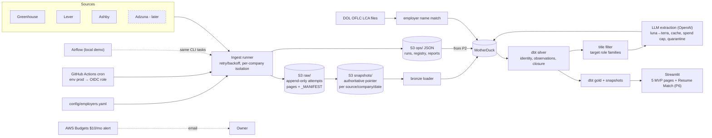

# JobPulse — Architecture

> Related: [SPEC.md](SPEC.md) · [ROADMAP.md](ROADMAP.md)

## Diagram



## Repo structure

```
jobpulse/
├── CLAUDE.md  README.md  Makefile  pyproject.toml  uv.lock  .env.example
├── config/            employers.yaml (converted from owner's seed list)
│                      sources.yaml  pipeline.yaml  extraction.yaml  locations.yaml
├── src/jobpulse/
│   ├── config.py  logging.py  http.py  cli.py
│   ├── connectors/    base.py  greenhouse.py  lever.py  ashby.py  (adzuna.py: later)
│   ├── ingest/        runner.py  manifest.py  pointer.py  s3_writer.py  report.py
│   ├── ops/           s3_ops.py (P1: JSON to S3)  load_ops.py (P2: → MotherDuck)
│   ├── bronze/        loader.py  normalize.py
│   ├── silver.py      (runs the dbt silver models with vars from config; run_dbt shared with gold)
│   ├── gold.py        (stages skill/city mapping tables, then runs the dbt gold models + snapshot)
│   ├── skills.py  location.py   (skill-name normalization shared with eval; place heuristic)
│   ├── env.py         (prod/dev switch: dev prefix guard, prefixed storage, local-only warehouse)
│   ├── warehouse.py   (MotherDuck / local DuckDB connection)
│   ├── extract/       schema.py  llm.py  cost.py  store.py (cache, queue, quarantine)  budget.py  runner.py
│   ├── secrets.py     (.env reader, Python only; redaction)
│   ├── visa/          lca_loader.py  employer_match.py
│   └── resume/        parse.py  match.py
├── dbt/               models/{staging,silver,gold}/  snapshots/  tests/generic/  macros/  profiles.yml
├── app/               Home.py  pages/   (5 MVP pages; Resume Match added in P6)
├── eval/              sample.py  sponsorship_sample.py  export_predictions.py  score.py  README.md  reports/
│                      label_app.py + label_io.py (local Streamlit labeling app; never reads predictions)
│                      pilot_analysis.py  salary_rules.py  salary_crosscheck.py  grounding_report.py  agreement.py (automated, no human labels)
│                      labels_template.csv (BLIND: id, title, company, text only)  predictions.csv (separate, gitignored)
├── scripts/           validate_employers.py  check_freshness.py  warehouse_counts.py
│                      extraction_counts.py  report_extraction_cost.py  gold_report.py
├── infra/terraform/   bootstrap/  (state bucket)
│                      main/       (data bucket, OIDC provider, role, budget)
├── airflow/           dags/jobpulse_daily.py  docker-compose.yml
├── tests/             unit/  integration/  fixtures/
├── .github/workflows/ ci.yml  daily_ingest.yml
└── docs/              SPEC.md  ARCHITECTURE.md  ROADMAP.md  NOTES.md
```

## Snapshot identity and idempotency

The design keeps the *logical* daily snapshot separate from the *execution* that produced it.

| Concept | Definition |
|---|---|
| `snapshot_date` | Logical UTC date. Taken from the `workflow_dispatch` input, or the scheduled run's date by default. |
| `attempt_id` | `gha-<run_id>-<run_attempt>` in Actions, `local-<ulid>` elsewhere. A "Re-run job" on the same workflow run increments `run_attempt`, so every execution has a distinct id. |
| Logical snapshot | (source, company, `snapshot_date`). For Adzuna (deferred), (source, search slice, `snapshot_date`). |
| Authoritative pointer | Exactly one per logical snapshot; it names the attempt whose data downstream uses. |

Rules:

1. **Raw is append-only.** Each attempt writes under its own `attempt=` prefix and never overwrites another attempt.
2. **Manifest last.** `_MANIFEST.json` is written after all pages, with `status` (`complete` / `incomplete` / `failed`), page hashes, record count, and a reason code if the attempt didn't complete.
3. **Pointer only on complete.** The pointer is written only after the attempt's manifest has `status="complete"` and every page hash checks out. Incomplete, failed, truncated, or rate-limited attempts never write or replace the pointer.
4. **Later complete attempt wins.** If a second complete attempt runs on the same day, it replaces the pointer. The write is guarded so the new manifest's `completed_at` must be later than the current pointer's. S3 versioning keeps the pointer's history.
5. **No overlap.** `daily_ingest.yml` uses `concurrency: {group: daily-ingest, cancel-in-progress: false}`.
6. **Live runs record today only.** `snapshot_date` must equal the current UTC date. This is enforced in three places: the workflow input check, the CLI (`resolve_snapshot_date`), and the runner. Past and future dates are rejected, so a fetch is never assigned to a missed day.
7. **Downstream reads pointers only.** Bronze is keyed on (source_id, board_id, snapshot_date, external_posting_id). When a pointer changes, the loader replaces that company-day's rows in one transaction, so row counts don't change.
8. **Closure.** A posting is closed only when it is absent from 2 consecutive authoritative snapshot dates for that company, or the source reports an authoritative closed status. The two absences must fall on calendar-adjacent dates that both have pointers. A date with no pointer never counts as an absence and breaks the streak. Adzuna (deferred) is never used for closure.

## S3 layout

One bucket, `jobpulse-data-<suffix>` in `us-east-1`:
- **Versioning:** on.
- **Encryption:** SSE-S3.
- **Public access:** Block Public Access on.
- **No lifecycle transition.** Our objects are small, and Standard-IA bills a 128 KB minimum per object, so moving them would cost more, not less.

```
raw/source=<src>/company=<board>/dt=<date>/attempt=<attempt_id>/page=0001.json.gz    # sha256 in object metadata
raw/source=<src>/company=<board>/dt=<date>/attempt=<attempt_id>/_MANIFEST.json       # written LAST
snapshots/source=<src>/company=<board>/dt=<date>/_AUTHORITATIVE.json                 # attempt_id, manifest_key, manifest_sha256, record_count, completed_at
ops/pipeline_runs/dt=<date>/attempt=<attempt_id>.json
ops/company_snapshots/dt=<date>/attempt=<attempt_id>.json
ops/source_registry/dt=<date>/attempt=<attempt_id>.json
ops/source_registry/latest.json
ops/run_reports/dt=<date>/attempt=<attempt_id>.json      # failed companies + reason codes; also rendered to $GITHUB_STEP_SUMMARY
```

## Table schemas (key columns)

### ops
In P1 these are JSON files under `ops/` in S3. From P2 they are loaded into the MotherDuck `ops` schema. They can always be rebuilt from S3.

| Table | Key columns |
|---|---|
| `source_registry` | source_id (PK), source_name, enabled, last_success_at, last_failure_at, last_cursor, records_fetched, attribution_url |
| `pipeline_runs` | attempt_id, snapshot_date, task (ingest/bronze/silver/extract/gold), source_id, started_at, finished_at, duration_s, status, rows_in, rows_kept, rows_dropped_json (reason → count), llm_cost_usd, env (gha/airflow/local) |
| `company_snapshots` | attempt_id, snapshot_date, source_id, board_id, status (complete/incomplete/failed), reason_code (`http_4xx`, `http_5xx`, `rate_limited`, `timeout`, `network_error`, `truncated`, `parse_error`, `board_not_found`, `storage_error`, `unexpected_error`), pages, record_count, manifest_key, is_authoritative |

### bronze (from P2)
| Table | Key columns |
|---|---|
| `raw_postings` | source_id, board_id, snapshot_date, attempt_id, external_posting_id, title, location_raw, apply_url, content_hash, object_key, loaded_at. One row per posting per authoritative snapshot date. **Unique** on (source_id, board_id, snapshot_date, external_posting_id). The four content fields (title, location, description, apply URL) come from one tested per-source mapping (`bronze/normalize.py`); `content_hash` covers only them, so volatile API fields never create a new version. The large fields are not stored here (see `posting_content`). |
| `posting_content` | source_id, external_posting_id, content_hash, first_snapshot_date, description_text, payload (JSON), loaded_at. **Unique** on (source_id, external_posting_id, content_hash). The description text and the raw API payload, **kept once per content version**, from the first observation of that content. An unchanged posting adds a `raw_postings` row (about 44 bytes compressed) but no new content row. `stg_raw_postings` joins it back, so silver and gold are unchanged. Old content nothing refers to (a replaced same-day attempt) is deleted at the end of each load. The S3 raw pages remain the complete, append-only record. |
| `snapshot_pointers` | source_id, board_id, company, snapshot_date, attempt_id, manifest_key, manifest_sha256, record_count, completed_at, loaded_at. **Unique** on (source_id, board_id, snapshot_date). One row per authoritative logical snapshot, including empty boards, which have no `raw_postings` rows. Closure needs it to know which dates are authoritative. |

The bronze loader lists `snapshots/` only (never `raw/`), re-verifies manifest and page hashes, and replaces a company-day's rows in one transaction when its pointer moves to a newer attempt. A failing snapshot is recorded with a reason and never stops the others.

### silver (dbt, schema `silver`)
| Model | Grain / key columns |
|---|---|
| `stg_raw_postings` (view) | adds `posting_key = sha256(source_id ‖ external_posting_id)` |
| `stg_snapshot_pointers` (view) | (source_id, board_id, snapshot_date), plus a `company_id` slug |
| `dim_postings` | posting_key (PK): source_id, external_posting_id, company_id, title, location_raw, description_text, apply_url, content_hash, first_seen_at, last_seen_at, last_confirmed_active_at, source_status (active/closed), closed_at, closure_reason (`absent_<N>_snapshots`; `authoritative` is reserved for sources that report closure), probable_duplicate_of (cross-source flag only; never merged) |
| `fct_posting_observations` | (posting_key, snapshot_date), observed (bool), attempt_id, content_hash. `observed=false` rows exist only for dates where the company has an authoritative pointer. |
| `dim_posting_versions` | (posting_key, valid_from), content_hash, valid_to. A new row only when content_hash changes. |
| `int_posting_closure` | posting_key: closed_date, closed_at, closure_reason |
| `int_posting_duplicates` | posting_key: probable_duplicate_of |

`probable_duplicate_of` points a posting at the earliest-seen posting with the same company, normalized title and normalized location in a **different** source. It is a flag, never a merge, and is never applied within one source.

Closure uses `warehouse.closure_consecutive_absences` (config, default 2), passed to dbt as a var. The absences must fall on **calendar-adjacent dates that both have a pointer**: a date without a pointer breaks the streak instead of counting. Only absences after a posting's last sighting count, so a reappearing posting is active again.

### extraction (schema `extract`, written by `jobpulse extract`)
Scope: only postings that pass the config-driven **title filter** (`silver.int_extraction_candidates`, built from `config/extraction.yaml` `title_filter`) are sent to the LLM. `title_family` there is a title heuristic used for stratified sampling only.

| Table | Key columns |
|---|---|
| `extractions` | PK (content_hash, schema_version, prompt_version), the **cache key**. posting_key, model, escalated, skills[], seniority, role_family, salary_min, salary_max, salary_currency, salary_period, salary_original_text, remote_policy, sponsorship_statement (`offered`/`not_offered`/`unspecified`), sponsorship_original_text, confidence, extracted_at, **salary_period_inferred**. `prompt_version` is a hash of the prompt text + JSON schema, so any change misses the cache. |
| `quarantine` | PK as above. raw_output, validation_errors, model_chain (`luna>terra`), attempts. Not retried until the prompt/schema version changes. |
| `queue` | content_hash (PK), posting_key, enqueued_at, reason (`budget_exhausted`), attempt_id. Cleared when the posting is extracted or quarantined. |
| `llm_calls` | call_id, attempt_id, content_hash, model, mode (`sync`/`batch`), input_tokens, output_tokens, cached_tokens, cost_usd, latency_ms, outcome (ok/invalid/error/escalated), created_at |
| `agreement` | PK (content_hash, schema_version, prompt_version, model). The escalation model's re-run output for the cross-model agreement sample (`eval/agreement.py`). Eval only: never read by the cache or the pipeline; its `llm_calls` rows have `mode='eval'` and are excluded from cost-per-1k. |
| `batches` | batch_id, attempt_id, input_file_id, model, request_count, est_cost_usd, schema_version, prompt_version, status, created_at, collected_at. A new batch is refused while one is uncollected. |

**Missing salary period.** The model sometimes returns an amount without a period and validation accepts it. A deterministic rule (`extract/period.py`, thresholds in `config/extraction.yaml` `salary_period_inference`) fills it when an amount exists and the period is empty: `year` if the amount (salary_min, else salary_max) is >= 20,000, `hour` if it is < 500, otherwise left empty. It runs when an extraction is stored and, once and idempotently, on rows already stored (no API call, no re-extraction). `salary_period_inferred = TRUE` marks filled values, and reports that judge the model (`salary_crosscheck`, agreement, the pilot's model-only row) ignore them.

Flow per posting: cache lookup (content hash) → first-pass model with Structured Outputs → Pydantic validation plus grounding checks (quoted salary/sponsorship text must appear in the posting) → on failure, **one** escalation call → on failure, quarantine. Transport errors are recorded and retried next run (never quarantined). Failures are isolated per posting.

**Spend cap.** Before each call the runner reserves its worst-case cost (estimated input + `max_output_tokens`, times `cap_safety_factor`) against the per-run cap; if it does not fit, the posting goes to `queue`. Defaults: $0.25 per daily run, $1.50 for `--backfill`/`--batch`. Raw bronze/silver data is never touched.

**Batch API.** `extract --batch submit` sends the first pass of the backlog as one batch (50% off, up to 24h); `extract --batch collect` parses results, runs escalations synchronously, and quarantines failures. Daily incremental runs are synchronous.

**Evaluation (what each report measures).** Reports are separate on purpose and named for what they are:

| Report (script) | Needs human labels? | What it measures | What it does NOT measure |
|---|---|---|---|
| Hand-labeled pilot (`eval/score.py`, `eval/pilot_analysis.py`) | yes (38 rows) | Agreement with the owner's labels, per field | Accuracy beyond n=38; the owner's labeling conventions are folded in at scoring time (seniority) or normalized (skill names), always shown next to the raw number |
| Salary cross-check (`eval/salary_crosscheck.py`) | no | Agreement between a regex pay-range parser and the model | Correctness: the parser has its own errors (it misreads European number formats and equity grants) |
| Grounding / validation (`eval/grounding_report.py`) | no | How often output passed the pipeline's own checks; whether quoted evidence is in the text | Whether a value is right |
| Cross-model agreement (`eval/agreement.py`) | no | Consistency of `gpt-6-luna` vs `gpt-6.1-terra` on the same prompt, on a seeded sample | Correctness: two models can be wrong together |

**Provider.** OpenAI (`gpt-6-luna` first pass, `gpt-6.1-terra` escalation), Responses API with `json_schema` strict output, called through the shared HTTP client; no provider SDK. Prices in `config/extraction.yaml` come from the OpenAI pricing page (checked 2026-11-09). The key is never printed, logged, or committed; error text is scrubbed.

### ref (visa; schema `ref`, loaded by `jobpulse load-lca`)
Source: US Department of Labor OFLC LCA disclosure data (H-1B), downloaded by hand into `data/oflc/` (dol.gov refuses automated requests; the folder is gitignored). Files, fiscal years, accepted column names and match settings are in `config/lca.yaml`; reviewed aliases in `config/lca_aliases.yaml`. **Evidence from public filings, not a promise of sponsorship.**

| Table | Key columns |
|---|---|
| `lca_disclosures` | One row per certified-or-otherwise-decided H-1B case of a **matched** employer, de-duplicated on `case_number` (the latest decision wins). case_number, fiscal_year, source_file, case_status, received_date, decision_date, visa_class, employer_name, employer_name_norm, company_id, job_title, soc_code, soc_title, full_time_position, total_worker_positions, worksite_city, worksite_state, wage_rate_from, wage_rate_to, wage_unit, prevailing_wage, pw_unit, pw_wage_level, loaded_at. Only these columns are read; attorney, agent, contact and FEIN columns never are. |
| `lca_employer_names` | Every distinct H-1B employer name per fiscal year with n_cases and n_certified (unmatched employers included, so near-misses can be reviewed). |
| `employer_lca_match` | company_id, lca_employer_name (normalized), example_name, match_method (`alias`, `exact`, `normalized`), match_confidence, reviewed (true for aliases), n_cases. Rebuilt from all loaded years on every load. |

**Matching is deterministic.** `exact`: the LCA name equals the company name (case-insensitive). `normalized`: equal after normalization (ASCII, lower case, punctuation removed, trailing legal suffixes such as Inc/LLC dropped). `alias`: listed in `config/lca_aliases.yaml` by the owner (`aliases`: another legal name of the same employer; `subsidiaries`: a subsidiary whose filings count for the parent, marked `relationship = 'subsidiary'` in `ref.employer_lca_match` and shown in the app; `excluded`: a name that normalizes to the company name but is not the company, never matched). Confidences are configured (exact 1.0, alias 1.0, normalized 0.9, evidence threshold 0.9). A normalized name that matches more than one company is **ambiguous and not matched**. Fuzzy similarity is used only to *suggest* candidates in a review sheet and never counts as a match. Because only matched employers' filings are stored, editing the aliases requires re-running `load-lca` on the files.

Loading is idempotent: loading a fiscal year replaces that year's rows; other years stay.

### gold (dbt, schema `gold`; built by `jobpulse build-gold`)
Built from silver and `extract.extractions`; it reads both and writes neither. Advertised salary only: LCA wages are never joined into advertised-salary models. The `*_lca_*` models below are a separate dataset built from `ref` and are labelled **evidence from public filings, not a promise of sponsorship**.

| Model | Grain / key columns |
|---|---|
| `fct_postings` | posting_key: company_id, source_id, title, `has_extraction`, `is_target_role` (an open posting whose title matches the extraction title filter), role_family, seniority, remote_policy, city (place label), city_name, city_state, city_country, `sponsorship_statement`, `sponsorship_quote` (the grounded quote from the posting), `sponsorship_class`, salary_min/max (as stated), salary_currency, salary_period, **`salary_period_inferred`**, salary_min_annual, salary_max_annual, `has_advertised_salary`, first_seen_date, closed_date, is_active, is_probable_duplicate. Every posting, active or closed; extracted fields are NULL and `has_extraction` is false until the posting's current content has been extracted. |
| `dim_company` | company_id: name, sources[], n_postings, n_active, n_extracted, n_active_offered, n_active_not_offered, `lca_match_confidence`, `lca_employer_names`, `lca_match_methods`, `lca_subsidiaries` (names of reviewed subsidiaries whose filings are counted), `n_lca_certified`, `n_lca_not_certified`, `lca_fiscal_years`, `visa_evidence_class` (filing history only, see below). Companies with no LCA match have NULL match fields and 0 counts. |
| `agg_lca_company_year` | (company_id, fiscal_year): n_certified (plain CERTIFIED only; this is the evidence), n_certified_positions, n_certified_withdrawn, n_withdrawn, n_denied, n_cases. Withdrawn and denied cases are shown separately and are not evidence. |
| `agg_lca_company_role` | (company_id, fiscal_year, role_family): certified LCAs by role family, mapped from the LCA job title with the same title rules as extraction (`config/extraction.yaml` `title_filter`); titles that match no family are `other`. |
| `agg_lca_wage_level` | (company_id, fiscal_year, wage_level I-IV or `unknown`): certified LCAs by DOL prevailing-wage level. |
| `agg_lca_wage_by_soc_city` | (role_family, worksite_state, worksite_city): OFFERED wage on certified LCAs (lower bound of the filed range, annualized with `gold.annualization`), n_certified, n_with_wage, n_wage_excluded, coverage_pct (n_with_wage / n_certified), p25/p50/p75 (NULL below `gold.min_salaries_for_percentiles`). **Never blended with advertised salary**; matched employers only, so not a market survey. An annualized wage outside `config/lca.yaml` `wage` (15,000 to 1,000,000 USD/year) is NULL and counted in `n_wage_excluded`: filers sometimes label an annual amount HOUR/WEEK/MONTH. Never repaired by guessing. (Grain is role family, not SOC code: SOC codes are in `int_lca_certified`.) |
| `int_lca_certified`, `int_company_lca` (schema `gold_stage`) | Working tables for the models above; not read by the app. |
| `dim_skill` | skill_id (sha256 of canonical_name): canonical_name, n_spellings. Names come from `jobpulse.skills.norm_skill`, the same function `eval/score.py` uses. |
| `bridge_posting_skill` | (posting_key, skill_id), deduplicated after normalization |
| `agg_skill_demand_weekly` | (week_start, skill_id, role_family): active_postings, new_postings, share_of_postings. Extracted, non-duplicate postings only; the share's denominator is the extracted postings active that week in the role family. In the first week of data every posting is "new" (history starts there), so that week is a baseline, not a spike. |
| `agg_salary_by_role` | (role_family, seniority, salary_currency): the same rules and columns as `agg_salary_by_role_city` without the city (most salary-bearing postings are remote or multi-location, so they have no single city and fell in an `unspecified` city bucket). The app uses it for "All cities" and the city table for a chosen city. |
| `agg_salary_by_role_city` | (role_family, seniority, city, salary_currency): n_postings, n_with_salary, coverage_pct, n_currency_salary, n_annualized, p25/p50/p75 of the annualized midpoint. **Advertised salary only.** Active, extracted, non-duplicate postings. `n_postings`, `n_with_salary` and `coverage_pct` describe the whole (role, seniority, city) group and repeat on each currency row (do not sum them across currencies). Percentiles are NULL below `gold.min_salaries_for_percentiles`. A group with no salary has one row with currency `none`. |
| `fct_snapshot_freshness` | (source_id, board_id): newest authoritative snapshot (`newest_snapshot_date`, `newest_completed_at`, `newest_record_count`), `max_age_hours` (from `freshness.max_age_hours`) and `built_at`. The app computes age against the current time, so the stale banner is right between builds. |
| `fct_pipeline_runs` | (attempt_id, task, source_id): status, duration, company counts, rows in/kept, `llm_cost_usd` (from `ops.pipeline_runs`; counts and cost only). |
| `agg_ingest_status_daily` | (snapshot_date, source_id, status, reason_code): boards and authoritative boards (from `ops.company_snapshots`). |
| `agg_data_quality` | metric: numerator and denominator over active, non-duplicate postings (extracted share, advertised salary, annualizable salary, city parsed, role family known, sponsorship stated). |
| `agg_llm_cost_daily` | (call_date, model, mode, outcome): calls, tokens and cost from `extract.llm_calls`. |
| `snapshots/snap_postings` | dbt snapshot (unique_key posting_key), `strategy=check`, `check_cols=[content_hash, source_status]`. Narrow (no description text). It runs in `build-gold`, so its history advances once per daily build and follows content and closure changes, not wall-clock time. |
| `int_latest_extraction` (schema `gold_stage`) | content_hash: the newest extraction across prompt/schema versions. |

**Annualization.** Only where the period is known (stated or rule-inferred, see "Missing salary period"): factors in `config/pipeline.yaml` `gold.annualization` (year 1, month 12, week 52, hour 2080). `day` is not annualized and a missing period is never guessed in gold, so those rows have NULL annual columns but still count in `n_with_salary`. Inferred periods are marked `salary_period_inferred`.

**City (a place, not just a name).** There is no structured location in the source data. `city` is a conservative heuristic on `location_raw` (`location.py`, rules in `config/locations.yaml`). A place is identified by city + state/province + country, so same-named cities never merge: `Dublin, California` (from "Dublin, CA" or "US-CA-Dublin") and `Dublin, Ireland` are different places. `fct_postings` carries `city` (display label, one per place), `city_name`, `city_state` and `city_country`. A state or country is only filled in for a bare city when the city is listed in `known_places` (for example "London" is United Kingdom); an unlisted bare city stays its own place with no state or country and never merges with a qualified one. `Dublin` is listed as Ireland (owner decision), so "Dublin" = "Dublin, Ireland", while "Dublin, CA" and "US-CA-Dublin" are Dublin, California. Remote-only, country-only and multi-location strings have no city. Share of active postings that get a city: run `scripts/gold_report.py`.

**Mapping tables.** `build-gold` first rebuilds `gold_stage.skill_map` (raw spelling to canonical name) and `gold_stage.location_map` (location_raw to place: label, city, state, country, key) in Python, then runs dbt. They are recomputed from scratch each run, so reruns are idempotent.

`dim_skill.category` is omitted: nothing in the data defines categories. `country` is `city_country`. `build-gold` creates empty `ref` tables if `load-lca` never ran, so gold builds with no visa data (every class is then `UNKNOWN`).

### Visa evidence classes
| Class | Meaning |
|---|---|
| `CONFIRMED_OFFERED` | The posting explicitly says sponsorship is offered. |
| `EXPLICITLY_UNAVAILABLE` | The posting explicitly says sponsorship is not offered. |
| `HISTORICAL_EVIDENCE` | The posting says nothing about sponsorship, but the employer has certified LCAs with name-match confidence at or above the configured threshold. |
| `UNKNOWN` | None of the above. |

The **company** class (`dim_company.visa_evidence_class`) reflects **filing history only**: `HISTORICAL_EVIDENCE` when the employer has certified LCAs under a name matched at or above the threshold, else `UNKNOWN`. It is always shown with `n_lca_certified` (for example, 3 filings is thin evidence). A posting statement is about that posting, so it is **not** rolled up into the company class: `fct_postings.sponsorship_class` is `CONFIRMED_OFFERED` / `EXPLICITLY_UNAVAILABLE` when the posting says so (with `sponsorship_quote`) and takes precedence over LCA history for that posting; an extracted posting that says nothing, and any posting not yet extracted, falls back to the company's LCA evidence (for an unextracted posting this means "the employer has filings", not "the posting is silent"). `dim_company` carries `n_active_offered` / `n_active_not_offered` so the app shows them beside the company class. Only plain `CERTIFIED` cases count as LCA evidence. By-role LCA counts are **lower bounds**: the role family is a title keyword match with the extraction rules, so titles like "Software Engineer, Data" fall in `other`.

## Streamlit app (`app/`, P5; deployment is P6)

`app/streamlit_app.py` is the entry point (`st.navigation`, five pages in `app/app_pages/`: Market overview, Hiring trends, Salary, Visa intelligence, Pipeline health). The layout uses Streamlit's responsive containers, so columns stack on a phone.

**Gold only, read only.** All reads go through `jobpulse.app_data.read_gold`: one `SELECT`/`WITH` statement, no comments, no write/DDL/attach/pragma/load keywords, and every table must be `gold.<name>` with the name in the `GOLD_TABLES` allow-list (the `gold_stage` working tables, bronze, silver, ops, extract and ref are refused). The connection is a read-only local DuckDB file (`JOBPULSE_APP_DB`) or MotherDuck with a **read-scaling token** (`MOTHERDUCK_READ_TOKEN`; never the write token). Pages never import duckdb. Pipeline Health reads the gold models over ops and LLM-call data (`fct_snapshot_freshness`, `fct_pipeline_runs`, `agg_ingest_status_daily`, `agg_data_quality`, `agg_llm_cost_daily`).

**Cost control.** Every query is cached for one hour (`st.cache_data`, `app_ui.CACHE_TTL_S`); gold changes once a day, and a longer cache spends fewer MotherDuck compute-unit hours. Freshness age is computed against the current time at view, so the stale banner stays right between builds.

**Rules the pages follow.** Advertised salary and LCA wages are separate tabs and are never blended; currencies are chosen, never converted; coverage is always shown. Visa views carry "Evidence from public filings, not a promise of sponsorship", show `n_certified` next to the company class, label by-role LCA counts as lower bounds, and quote the posting text for sponsorship statements. Sponsorship is a filter, never part of a match score.

**Tests (`tests/unit/test_app.py`, run in CI with pytest).** `AppTest` renders every page against a gold fixture built by the real pipeline (with data, and with no extraction/visa/ops data), plus the stale-data banner, the visa disclaimer/quote/count, the separate salary tabs, a missing-data message, the read-only connection, the refused statements and a static check that app code names only allow-listed gold tables.

Run locally: `JOBPULSE_APP_DB=path/to/warehouse.duckdb uv run streamlit run app/streamlit_app.py`.

## GitHub OIDC → AWS

Trust policy on the ingest role (exact):

```json
{
  "Version": "2012-10-17",
  "Statement": [
    {
      "Effect": "Allow",
      "Principal": {
        "Federated": "arn:aws:iam::<ACCOUNT_ID>:oidc-provider/token.actions.githubusercontent.com"
      },
      "Action": "sts:AssumeRoleWithWebIdentity",
      "Condition": {
        "StringEquals": {
          "token.actions.githubusercontent.com:aud": "sts.amazonaws.com",
          "token.actions.githubusercontent.com:sub": "repo:akshaygovindd@97725846/jobpulse@1451951419:environment:prod"
        }
      }
    }
  ]
}
```

- **Workflow side.** The `daily_ingest` job declares `environment: prod` and `permissions: { id-token: write, contents: read }`.
- **Environment protection.** The GitHub `prod` environment's deployment-branch rule allows only `main`. A branch or PR workflow therefore can't get a `prod` token.
- **Subject claim.** This repo uses GitHub's **immutable subject format**, so the `sub` claim embeds the numeric owner and repo IDs: `repo:<owner>@<owner_id>/<repo>@<repo_id>:environment:<env>`.
  - The plain form `repo:akshaygovindd/jobpulse:environment:prod` never matches. The first ingest run failed with `AssumeRoleWithWebIdentity` denied because of it.
  - The exact value was confirmed on 2026-11-10 in two ways: from a decoded token, and from `GET /repos/akshaygovindd/jobpulse/actions/oidc/customization/sub` (`use_default: true`, `use_immutable_subject: true`).
  - Terraform holds it in `var.github_oidc_subject`, matched with `StringEquals`.
  - Because the IDs survive renames, a repo that is deleted and re-created under the same name can't assume the role.
  - Changing the subject template would change `sub` and break this trust policy.
- **Role permissions.**
  - Allowed: `s3:PutObject` and `s3:GetObject` on `raw/*`, `snapshots/*`, and `ops/*`, plus `s3:ListBucket` on the bucket.
  - Not allowed: anything else, including budgets or IAM.

## Cost guardrail

- **Budget.** `aws_budgets_budget` (cost, monthly, limit **$10**).
- **Notifications.** Email at 80% of actual spend and at 100% of forecast spend.
- **Recipient.** The email address comes from the `budget_alert_email` tfvar, which isn't committed.
- **This is an alert, not a spending cap.** AWS billing data lags by hours, and nothing is stopped automatically.
- **No confirmation step.** AWS Budgets email subscribers get no opt-in email. To verify the subscriber, use the console or `aws budgets describe-subscribers-for-notification`.

## Daily workflow

`daily_ingest.yml` has four jobs, all in the `prod` environment:
1. `ingest`: `jobpulse ingest` then `check-freshness`. Needs no MotherDuck and no dbt (`uv sync --no-default-groups`).
2. `warehouse` (`needs: ingest`, runs unless cancelled): `load-ops` → `load-bronze` → `build-silver`. `MOTHERDUCK_TOKEN` (a `prod` environment secret) is set only on those three steps. A MotherDuck problem cannot fail ingest, and the next run catches up from the pointers because every step is idempotent.
3. `extract` (`needs: warehouse`, only when it succeeded): `jobpulse extract --cap 0.25`.
4. `gold` (`needs: [warehouse, extract]`, runs when `warehouse` succeeded, **even if `extract` failed or hit its cap**): `jobpulse build-gold`. Gold joins `extract.extractions`, so it must run after extract; running it earlier would lag extraction by a day. If extract did not finish, `extract.extractions` still holds everything extracted so far (at worst yesterday's), so gold builds from that and postings that are new or changed show `has_extraction = false` until the next successful extract. It is skipped only when `warehouse` failed (silver would be stale). It needs only `MOTHERDUCK_TOKEN` and the dbt group: no AWS, no OpenAI key.

DuckDB is pinned to 1.5.6 because MotherDuck refuses newer clients; bump it only after MotherDuck announces support.

## Environments

| | Production | Local demo (dev) |
|---|---|---|
| Scheduler | GitHub Actions `daily_ingest.yml` (cron `17 9 * * *` + `workflow_dispatch` with `snapshot_date` input) | Airflow in Docker Compose (`airflow/`), manual triggers only |
| CLI mode | `--env prod` (default) | `--env dev` (`JOBPULSE_ENV=dev`) |
| Raw/ops storage | S3 bucket, roots `raw/`, `snapshots/`, `ops/` | A local directory (`airflow/demo-data/storage`), via `--local-dir`. If S3 were used in dev, every key goes under `storage.dev_prefix` (`dev/`) |
| Warehouse | MotherDuck | A local DuckDB file (`airflow/demo-data/demo.duckdb`). Dev refuses MotherDuck |
| Credentials | OIDC to AWS (`prod`, `main` only); GitHub `prod` secrets for `MOTHERDUCK_TOKEN` and `OPENAI_API_KEY` | **None in the container**: no AWS, no MotherDuck token, no OpenAI key (the key is added only by the opt-in `docker-compose.extract.yml`) |
| `extract` | Real calls, capped (`--cap 0.25`) | Dry run unless the DAG is triggered with `real_extract: true` and the opt-in override is used |
| Status | **The real daily pipeline.** | Runs the same CLI tasks (`ingest`, `load-ops`, `load-bronze`, `build-silver`, `extract`, `build-gold`) to show orchestration. **Not** production, and it does not exercise S3 or MotherDuck. |

**Why dev cannot touch prod (layers):**
1. The Compose service has no credentials and no `env_file`; the image build uses an allow-list (`airflow/Dockerfile.dockerignore`), so `.env` never enters the image. The DAG's first task fails the run if any AWS, MotherDuck or bucket variable is present.
2. `--env dev` makes the CLI require a local `--db` (a `md:` path or URL is refused, and the MotherDuck token is never read), and wraps S3 in a prefix wrapper (`env.py`).
3. `storage.dev_prefix` is validated against `storage.prod_prefixes`: it must be non-empty, end in `/`, and neither sit inside nor above `raw/`, `snapshots/` or `ops/`.

`tests/unit/test_env.py` and `tests/unit/test_airflow_demo.py` pin these properties. The end-to-end Docker run is manual: see `airflow/README.md` for the commands.

Terraform: `infra/terraform/bootstrap` creates the state bucket (local state, S3 native lockfile for the main root). `infra/terraform/main` holds the data bucket, OIDC provider, role, and budget. The owner runs `plan` and `apply` locally.
