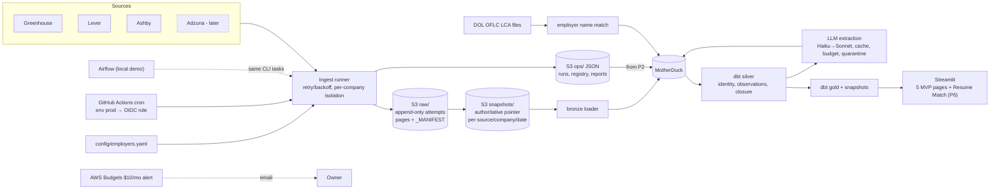

# JobPulse — Architecture

> Related: [SPEC.md](SPEC.md) · [ROADMAP.md](ROADMAP.md)

## Diagram



## Repo structure

```
jobpulse/
├── CLAUDE.md  README.md  Makefile  pyproject.toml  uv.lock  .env.example
├── config/            employers.yaml (converted from owner's seed list)
│                      sources.yaml  pipeline.yaml  extraction.yaml
├── src/jobpulse/
│   ├── config.py  logging.py  http.py  cli.py
│   ├── connectors/    base.py  greenhouse.py  lever.py  ashby.py  (adzuna.py: later)
│   ├── ingest/        runner.py  manifest.py  pointer.py  s3_writer.py  report.py
│   ├── ops/           s3_ops.py (P1: JSON to S3)  load_ops.py (P2: → MotherDuck)
│   ├── bronze/        loader.py  normalize.py
│   ├── silver.py      (runs the dbt project with vars from config)
│   ├── warehouse.py   (MotherDuck / local DuckDB connection)
│   ├── extract/       schema.py  llm.py  cache.py  budget.py  runner.py
│   ├── visa/          lca_loader.py  employer_match.py
│   └── resume/        parse.py  match.py
├── dbt/               models/{staging,silver,gold}/  snapshots/  tests/generic/  macros/  profiles.yml
├── app/               Home.py  pages/   (5 MVP pages; Resume Match added in P6)
├── eval/              labels_template.csv  sample.py  score.py  reports/
├── scripts/           validate_employers.py  check_freshness.py  report_metrics.py
├── infra/terraform/   bootstrap/  (state bucket)
│                      main/       (data bucket, OIDC provider, role, budget)
├── airflow/           dags/jobpulse_daily.py  docker-compose.yml
├── tests/             unit/  integration/  fixtures/
├── .github/workflows/ ci.yml  daily_ingest.yml
└── docs/              SPEC.md  ARCHITECTURE.md  ROADMAP.md  NOTES.md
```

## Snapshot identity and idempotency

The design keeps the *logical* daily snapshot separate from the *execution* that produced it.

| Concept | Definition |
|---|---|
| `snapshot_date` | Logical UTC date. Taken from the `workflow_dispatch` input, or the scheduled run's date by default. |
| `attempt_id` | `gha-<run_id>-<run_attempt>` in Actions, `local-<ulid>` elsewhere. A "Re-run job" on the same workflow run increments `run_attempt`, so every execution has a distinct id. |
| Logical snapshot | (source, company, `snapshot_date`). For Adzuna (deferred), (source, search slice, `snapshot_date`). |
| Authoritative pointer | Exactly one per logical snapshot; it names the attempt whose data downstream uses. |

Rules:

1. **Raw is append-only.** Each attempt writes under its own `attempt=` prefix and never overwrites another attempt.
2. **Manifest last.** `_MANIFEST.json` is written after all pages, with `status` (`complete` / `incomplete` / `failed`), page hashes, record count, and a reason code if the attempt didn't complete.
3. **Pointer only on complete.** The pointer is written only after the attempt's manifest has `status="complete"` and every page hash checks out. Incomplete, failed, truncated, or rate-limited attempts never write or replace the pointer.
4. **Later complete attempt wins.** If a second complete attempt runs on the same day, it replaces the pointer. The write is guarded so the new manifest's `completed_at` must be later than the current pointer's. S3 versioning keeps the pointer's history.
5. **No overlap.** `daily_ingest.yml` uses `concurrency: {group: daily-ingest, cancel-in-progress: false}`.
6. **Live runs record today only.** `snapshot_date` must equal the current UTC date. This is enforced in three places: the workflow input check, the CLI (`resolve_snapshot_date`), and the runner. Past and future dates are rejected, so a fetch is never assigned to a missed day.
7. **Downstream reads pointers only.** Bronze is keyed on (source_id, board_id, snapshot_date, external_posting_id). When a pointer changes, the loader replaces that company-day's rows in one transaction, so row counts don't change.
8. **Closure.** A posting is closed only when it is absent from 2 consecutive authoritative snapshot dates for that company, or the source reports an authoritative closed status. The two absences must fall on calendar-adjacent dates that both have pointers. A date with no pointer never counts as an absence and breaks the streak. Adzuna (deferred) is never used for closure.

## S3 layout

One bucket, `jobpulse-data-<suffix>` in `us-east-1`:
- **Versioning:** on.
- **Encryption:** SSE-S3.
- **Public access:** Block Public Access on.
- **No lifecycle transition.** Our objects are small, and Standard-IA bills a 128 KB minimum per object, so moving them would cost more, not less.

```
raw/source=<src>/company=<board>/dt=<date>/attempt=<attempt_id>/page=0001.json.gz    # sha256 in object metadata
raw/source=<src>/company=<board>/dt=<date>/attempt=<attempt_id>/_MANIFEST.json       # written LAST
snapshots/source=<src>/company=<board>/dt=<date>/_AUTHORITATIVE.json                 # attempt_id, manifest_key, manifest_sha256, record_count, completed_at
ops/pipeline_runs/dt=<date>/attempt=<attempt_id>.json
ops/company_snapshots/dt=<date>/attempt=<attempt_id>.json
ops/source_registry/dt=<date>/attempt=<attempt_id>.json
ops/source_registry/latest.json
ops/run_reports/dt=<date>/attempt=<attempt_id>.json      # failed companies + reason codes; also rendered to $GITHUB_STEP_SUMMARY
```

## Table schemas (key columns)

### ops
In P1 these are JSON files under `ops/` in S3. From P2 they are loaded into the MotherDuck `ops` schema. They can always be rebuilt from S3.

| Table | Key columns |
|---|---|
| `source_registry` | source_id (PK), source_name, enabled, last_success_at, last_failure_at, last_cursor, records_fetched, attribution_url |
| `pipeline_runs` | attempt_id, snapshot_date, task (ingest/bronze/silver/extract/gold), source_id, started_at, finished_at, duration_s, status, rows_in, rows_kept, rows_dropped_json (reason → count), llm_cost_usd, env (gha/airflow/local) |
| `company_snapshots` | attempt_id, snapshot_date, source_id, board_id, status (complete/incomplete/failed), reason_code (`http_4xx`, `http_5xx`, `rate_limited`, `timeout`, `network_error`, `truncated`, `parse_error`, `board_not_found`, `storage_error`, `unexpected_error`), pages, record_count, manifest_key, is_authoritative |

### bronze (from P2)
| Table | Key columns |
|---|---|
| `raw_postings` | source_id, board_id, snapshot_date, attempt_id, external_posting_id, title, location_raw, description_text, apply_url, content_hash, payload (JSON), object_key, loaded_at. **Unique** on (source_id, board_id, snapshot_date, external_posting_id). The four content fields come from one tested per-source mapping (`bronze/normalize.py`); `content_hash` covers only them, so volatile API fields never create a new version. |
| `snapshot_pointers` | source_id, board_id, company, snapshot_date, attempt_id, manifest_key, manifest_sha256, record_count, completed_at, loaded_at. **Unique** on (source_id, board_id, snapshot_date). One row per authoritative logical snapshot, including empty boards, which have no `raw_postings` rows. Closure needs it to know which dates are authoritative. |

The bronze loader lists `snapshots/` only (never `raw/`), re-verifies manifest and page hashes, and replaces a company-day's rows in one transaction when its pointer moves to a newer attempt. A failing snapshot is recorded with a reason and never stops the others.

### silver (dbt, schema `silver`)
| Model | Grain / key columns |
|---|---|
| `stg_raw_postings` (view) | adds `posting_key = sha256(source_id ‖ external_posting_id)` |
| `stg_snapshot_pointers` (view) | (source_id, board_id, snapshot_date), plus a `company_id` slug |
| `dim_postings` | posting_key (PK): source_id, external_posting_id, company_id, title, location_raw, description_text, apply_url, content_hash, first_seen_at, last_seen_at, last_confirmed_active_at, source_status (active/closed), closed_at, closure_reason (`absent_<N>_snapshots`; `authoritative` is reserved for sources that report closure), probable_duplicate_of (cross-source flag only; never merged) |
| `fct_posting_observations` | (posting_key, snapshot_date), observed (bool), attempt_id, content_hash. `observed=false` rows exist only for dates where the company has an authoritative pointer. |
| `dim_posting_versions` | (posting_key, valid_from), content_hash, valid_to. A new row only when content_hash changes. |
| `int_posting_closure` | posting_key: closed_date, closed_at, closure_reason |
| `int_posting_duplicates` | posting_key: probable_duplicate_of |

`probable_duplicate_of` points a posting at the earliest-seen posting with the same company, normalized title and normalized location in a **different** source. It is a flag, never a merge, and is never applied within one source.

Closure uses `warehouse.closure_consecutive_absences` (config, default 2), passed to dbt as a var. The absences must fall on **calendar-adjacent dates that both have a pointer**: a date without a pointer breaks the streak instead of counting. Only absences after a posting's last sighting count, so a reappearing posting is active again.

### extraction
| Table | Key columns |
|---|---|
| `extractions` | content_hash (PK, cache key), posting_key, schema_version, model, skills[], seniority, role_family, salary_min, salary_max, salary_currency, salary_period, salary_original_text, remote_policy, sponsorship_statement, sponsorship_original_text, confidence, extracted_at |
| `quarantine` | content_hash, posting_key, raw_output, validation_errors, model_chain, attempts |
| `queue` | posting_key, content_hash, enqueued_at, reason (new/changed/budget_exhausted) |
| `llm_calls` | call_id, attempt_id, content_hash, model, input_tokens, output_tokens, cost_usd, latency_ms, outcome (ok/invalid/error/escalated) |

### ref (visa)
| Table | Key columns |
|---|---|
| `lca_disclosures` | case_number, fiscal_year, case_status, employer_name, soc_code, soc_title, job_title, worksite_city, worksite_state, wage_rate_from, wage_rate_to, wage_unit, prevailing_wage, pw_wage_level, wage_basis |
| `employer_lca_match` | company_id, lca_employer_name, match_method (exact/normalized/fuzzy), match_confidence, reviewed |

### gold (dbt)
| Model | Grain / key columns |
|---|---|
| `fct_postings` | posting_key: company_id, role_family, seniority, remote_policy, city, country, salary_min_annual, salary_max_annual, salary_currency, has_advertised_salary, sponsorship_class, first_seen_date, closed_date, is_active, is_probable_duplicate, source_id |
| `dim_company` | company_id: name, sources[], lca_match_confidence, visa_evidence_class |
| `dim_skill` | skill_id: canonical_name, category |
| `bridge_posting_skill` | (posting_key, skill_id) |
| `agg_skill_demand_weekly` | (week_start, skill_id, role_family): active_postings, new_postings, share_of_postings |
| `agg_salary_by_role_city` | (role_family, seniority, city): n_postings, n_with_salary, coverage_pct, p25/p50/p75. **Advertised salary only.** |
| `agg_lca_wage_by_soc_city` | (fiscal_year, soc_code, worksite_city): LCA wages. **Separate model; never joined into advertised salary.** |
| `snapshots/snap_postings` | dbt snapshot, `strategy=check`, `check_cols=[content_hash, source_status]`. It runs after each silver build, so its history follows authoritative observations, not wall-clock time. |

### Visa evidence classes
| Class | Meaning |
|---|---|
| `CONFIRMED_OFFERED` | The posting explicitly says sponsorship is offered. |
| `EXPLICITLY_UNAVAILABLE` | The posting explicitly says sponsorship is not offered. |
| `HISTORICAL_EVIDENCE` | The posting says nothing about sponsorship, but the employer has certified LCAs with name-match confidence at or above the configured threshold. |
| `UNKNOWN` | None of the above. |

What the posting says takes precedence over LCA history. The UI always shows the evidence behind a class, never a promise. Sponsorship is a filter and is never part of the match score.

## GitHub OIDC → AWS

Trust policy on the ingest role (exact):

```json
{
  "Version": "2012-10-17",
  "Statement": [
    {
      "Effect": "Allow",
      "Principal": {
        "Federated": "arn:aws:iam::<ACCOUNT_ID>:oidc-provider/token.actions.githubusercontent.com"
      },
      "Action": "sts:AssumeRoleWithWebIdentity",
      "Condition": {
        "StringEquals": {
          "token.actions.githubusercontent.com:aud": "sts.amazonaws.com",
          "token.actions.githubusercontent.com:sub": "repo:akshaygovindd@97725846/jobpulse@1451951419:environment:prod"
        }
      }
    }
  ]
}
```

- **Workflow side.** The `daily_ingest` job declares `environment: prod` and `permissions: { id-token: write, contents: read }`.
- **Environment protection.** The GitHub `prod` environment's deployment-branch rule allows only `main`. A branch or PR workflow therefore can't get a `prod` token.
- **Subject claim.** This repo uses GitHub's **immutable subject format**, so the `sub` claim embeds the numeric owner and repo IDs: `repo:<owner>@<owner_id>/<repo>@<repo_id>:environment:<env>`.
  - The plain form `repo:akshaygovindd/jobpulse:environment:prod` never matches. The first ingest run failed with `AssumeRoleWithWebIdentity` denied because of it.
  - The exact value was confirmed on 2026-11-10 in two ways: from a decoded token, and from `GET /repos/akshaygovindd/jobpulse/actions/oidc/customization/sub` (`use_default: true`, `use_immutable_subject: true`).
  - Terraform holds it in `var.github_oidc_subject`, matched with `StringEquals`.
  - Because the IDs survive renames, a repo that is deleted and re-created under the same name can't assume the role.
  - Changing the subject template would change `sub` and break this trust policy.
- **Role permissions.**
  - Allowed: `s3:PutObject` and `s3:GetObject` on `raw/*`, `snapshots/*`, and `ops/*`, plus `s3:ListBucket` on the bucket.
  - Not allowed: anything else, including budgets or IAM.

## Cost guardrail

- **Budget.** `aws_budgets_budget` (cost, monthly, limit **$10**).
- **Notifications.** Email at 80% of actual spend and at 100% of forecast spend.
- **Recipient.** The email address comes from the `budget_alert_email` tfvar, which isn't committed.
- **This is an alert, not a spending cap.** AWS billing data lags by hours, and nothing is stopped automatically.
- **No confirmation step.** AWS Budgets email subscribers get no opt-in email. To verify the subscriber, use the console or `aws budgets describe-subscribers-for-notification`.

## Daily workflow

`daily_ingest.yml` has two jobs, both in the `prod` environment:
1. `ingest`: `jobpulse ingest` then `check-freshness`. Needs no MotherDuck and no dbt (`uv sync --no-default-groups`).
2. `warehouse` (`needs: ingest`, runs unless cancelled): `load-ops` → `load-bronze` → `build-silver`. `MOTHERDUCK_TOKEN` (a `prod` environment secret) is set only on those three steps. A MotherDuck problem cannot fail ingest, and the next run catches up from the pointers because every step is idempotent.

DuckDB is pinned to 1.5.6 because MotherDuck refuses newer clients; bump it only after MotherDuck announces support.

## Environments

| | Production | Local demo |
|---|---|---|
| Scheduler | GitHub Actions `daily_ingest.yml` (cron `17 9 * * *` + `workflow_dispatch` with `snapshot_date` input) | Airflow in Docker Compose (`airflow/`) |
| AWS auth | OIDC, `prod` environment, `main` only | Owner's local AWS profile against a dev S3 prefix |
| Warehouse | MotherDuck (from P2) | Dev MotherDuck DB or local DuckDB file |
| Secrets | GitHub `prod` environment secrets (MotherDuck from P2, LLM; Adzuna if revived) | `.env` (gitignored), template in `.env.example` |
| Status | **The real daily pipeline.** | Runs the same CLI tasks (`jobpulse ingest`, `load-ops`, `load-bronze`, `build-silver`, `extract`) to show orchestration; it is **not** the production scheduler. |

Terraform: `infra/terraform/bootstrap` creates the state bucket (local state, S3 native lockfile for the main root). `infra/terraform/main` holds the data bucket, OIDC provider, role, and budget. The owner runs `plan` and `apply` locally.
